# MusicContest: навчально-науковий довідник до лабораторних робіт №1–3

> Мова матеріалів: українська; англійська використовується для технічних назв і міжнародних матеріалів. [Мовна політика](EDITORIAL_LANGUAGE_POLICY.md) · [Редакційний стандарт](EDITORIAL_WRITING_STANDARD.md).

**Дисципліна:** програмування мовою C# і технології .NET.  
**Предметна область:** український вокальний конкурс.  
**Середовище:** .NET 8, C#, xUnit, Entity Framework Core 8, SQLite, MongoDB (додаткове завдання).  
**Призначення документа:** єдина інструкція для читання коду, самоперевірки та захисту **всіх трьох лабораторних**. Приклади пояснюють **реальні механізми цього репозиторію**, а не абстрактний сторонній проєкт.

> **Як читати цей довідник:** спочатку ознайомтеся з розділами 1–2 (модель), далі з розділом відповідної лабораторної. Кожна схема супроводжується текстовим поясненням. Код дивіться за посиланнями на файли. Демонстраційні учасники й музичний репертуар: українські; імена конкурсантів та назви навчальних колективів є умовними, дані про тривалість і тональність пісень використовуються лише як демонстраційні.

## Навігація

| Розділ | Що вивчити |
|---|---|
| [1. Карта проєкту](#1-карта-проєкту) | Архітектура, ролі проєктів і залежності |
| [2. Єдина предметна модель](#2-єдина-предметна-модель) | Учасник, співак, гурт, пісня, виступ |
| [3. Лабораторна №1: ООП](#3-лабораторна-1-основи-c-та-обєктноорієнтованого-програмування) | Наслідування, поліморфізм, делегати, події, generic CRUD, JSON |
| [4. Лабораторна №2: асинхронність](#4-лабораторна-2-багатопотоковість-асинхронність-ienumerable-та-linq) | async/await, паралелізм, LINQ, thread safety |
| [5. Лабораторна №3: бази даних](#5-лабораторна-3-entity-framework-core-та-бази-даних) | EF Core, SQLite, TPT, міграції, зв'язки та Repository |
| [6. Реляційна ERD](#6-erd-діаграма-та-кардинальності) | PK/FK, 1:1, 1:N, M:N |
| [7. MongoDB](#7-mongodb-додаткове-завдання-лр3) | Документи, вкладені поля й альтернативний репозиторій |
| [8. Словник](#8-короткий-словник-термінів) | Визначення для усного захисту |
| [9. Запуск і тести](#9-як-запустити-й-перевірити) | Команди, логи, PDF, перевірка SQLite |
| [10. Підказки для захисту](#10-підказки-та-контрольні-запитання) | Запитання, типові помилки та короткі відповіді |
| [11. Офіційні джерела](#11-офіційні-джерела-та-додаткова-література) | Документація Microsoft і MongoDB |

---

## 1. Карта проєкту

[Редакційний стандарт](EDITORIAL_WRITING_STANDARD.md) застосовується до пояснень, контрольних відповідей і звітів.

### 1.1. Структура

| Каталог / файл | Призначення |
|---|---|
| [`MusicContest.Common`](MusicContest.Common/) | Доменні класи, контракти, синхронний і асинхронний CRUD; приклади синхронізації |
| [`MusicContest.Common/Data/UkrainianMusicData.cs`](MusicContest.Common/Data/UkrainianMusicData.cs) | Спільний демонстраційний набір українських імен, гуртів і пісень |
| [`MusicContest.Console`](MusicContest.Console/) | Запуск демонстрацій ЛР1, ЛР2, ЛР3; фактичний консольний вивід |
| [`MusicContest.Common.Tests`](MusicContest.Common.Tests/) | xUnit-тести для CRUD, багатопотоковості та SQLite |
| [`MusicContest.Infrastructure`](MusicContest.Infrastructure/) | EF-моделі, `DbContext`, Fluent API, міграції, SQLite та реалізація репозиторію |
| [`MusicContest.Nosql`](MusicContest.Nosql/) | Додаткова реалізація репозиторію через MongoDB |
| [`docs/`](docs/) | SQLite, журнали перевірок, фактичні скріншоти, ERD та PDF-звіти |
| [`LAB3_CONTROL_QUESTIONS.md`](LAB3_CONTROL_QUESTIONS.md) | Розгорнуті відповіді на 13 запитань ЛР3 |
| [`CONTROL_QUESTIONS.md`](CONTROL_QUESTIONS.md) | Питання та пояснення ЛР1 |
| [`LAB2_CONTROL_QUESTIONS.md`](LAB2_CONTROL_QUESTIONS.md) | Питання та пояснення ЛР2 |

### 1.2. Архітектура

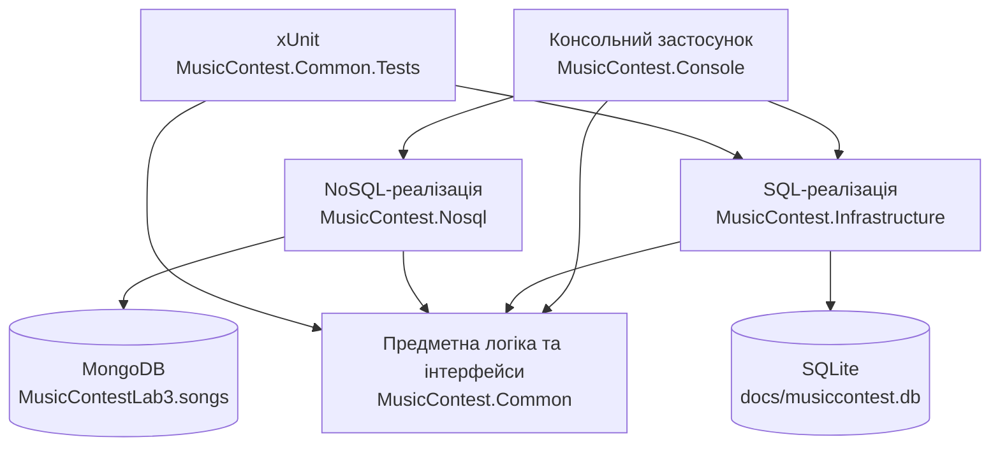

**Пояснення:** `Common` містить **що робить система**, а `Infrastructure` і `Nosql`: **де й як зберігаються її дані**. Інтерфейс `IRepository<T>` дозволяє використовувати один CRUD-контракт для різних сховищ.

### 1.3. Послідовність лабораторних

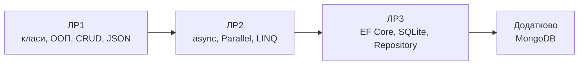

ЛР2 розвиває код ЛР1, а ЛР3 використовує модель і контракт асинхронного CRUD із попередніх робіт. Тому в остаточній гілці `lab3` є матеріали **всіх трьох** лабораторних. Окремі історичні гілки: `lab1` і `lab2`.

---

## 2. Єдина предметна модель

Об'єкт дослідження: **український вокальний конкурс**: сольні виконавці, вокальні гурти, пісні та оцінювані виступи.

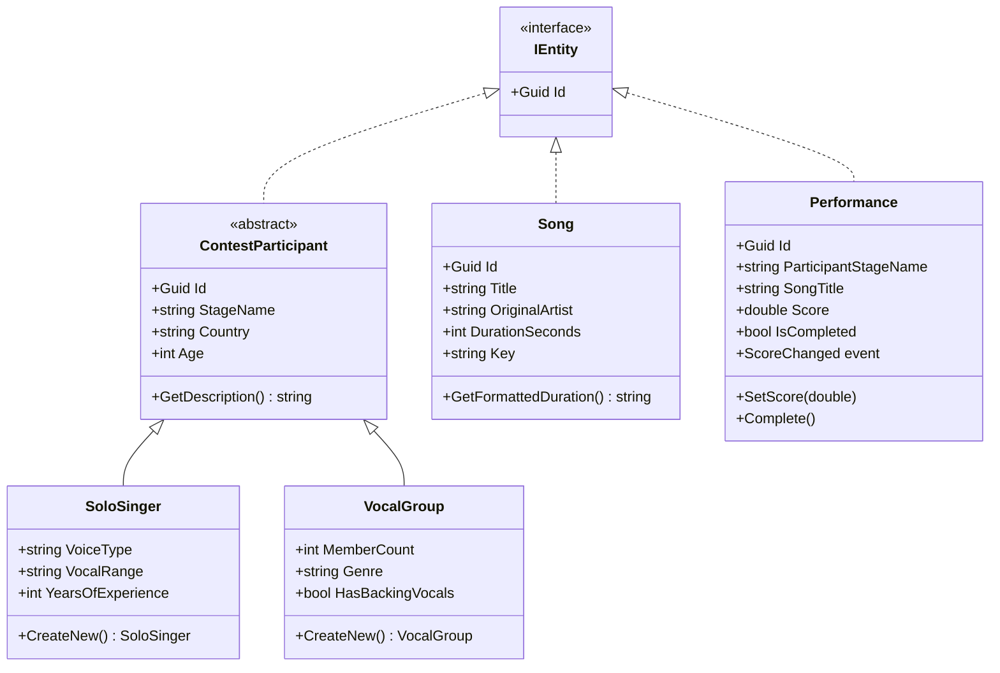

**Як прочитати схему:** стрілка з трикутником указує **на базовий клас**. `SoloSinger` та `VocalGroup` успадковують загальні властивості `ContestParticipant` і додають власні поля. `ContestParticipant` є `abstract`: безпосередньо створити його об'єкт не можна.

**Навчальний приклад українських даних:** `Олена Ковальчук`: сольна учасниця, `Дніпровські голоси`: вокальний гурт. Пісні: `Червона рута` (Володимир Івасюк), `Обійми` (Океан Ельзи), `Щедрик` (Микола Леонтович). **Імена конкурсантів і назви конкурсних гуртів вигадані; це не твердження про реальні заявки на конкурс.**

---

## 3. Лабораторна №1. Основи C# та об'єктноорієнтованого програмування

### 3.1. Мета

Закріпити роботу з **класами, об'єктами, властивостями, конструкторами, наслідуванням, поліморфізмом, статичними членами, делегатами, подіями, методами розширення та generic CRUD**. Зберігання/читання JSON: додаткова демонстрація.

### 3.2. Чотири принципи ООП

| Принцип | Суть | Приклад у MusicContest |
|---|---|---|
| **Інкапсуляція** | Приховати внутрішній стан і керувати доступом | Приватний лічильник `_createdCount` у `ContestParticipant` |
| **Наслідування** | Перенести спільні властивості в базовий клас | `SoloSinger : ContestParticipant` |
| **Поліморфізм** | Один виклик може мати різну реалізацію | Перевизначений `GetDescription()` |
| **Абстракція** | Описати спільну сутність без конкретного екземпляра | Абстрактний `ContestParticipant` і інтерфейс `IEntity` |

### 3.3. Механізм наслідування

```csharp
// Спільні ознаки всіх учасників:
public abstract class ContestParticipant : IEntity
{
    public Guid Id { get; set; }
    public string StageName { get; set; } = "";
    public string Country { get; set; } = "";
    public int Age { get; set; }
    public virtual string GetDescription() => StageName;
}

// Специфічні ознаки сольного виконавця:
public class SoloSinger : ContestParticipant
{
    public string VoiceType { get; set; } = "";
    public override string GetDescription() =>
        $"Сольний виконавець: {base.GetDescription()}";
}
```

*Цей фрагмент: скорочена навчальна ілюстрація; повні реалізації:* [`ContestParticipant.cs`](MusicContest.Common/Models/ContestParticipant.cs), [`SoloSinger.cs`](MusicContest.Common/Models/SoloSinger.cs), [`VocalGroup.cs`](MusicContest.Common/Models/VocalGroup.cs).

### 3.4. Делегат і подія

- **Делегат** (`delegate`) описує тип методу, який дозволено викликати.
- **Подія** (`event`) повідомляє підписників про зміну стану.
- `Performance.SetScore(92.0)` змінює оцінку та викликає подію `ScoreChanged`.
- Обробник реєструється оператором `+=` і отримує попередню та нову оцінки.

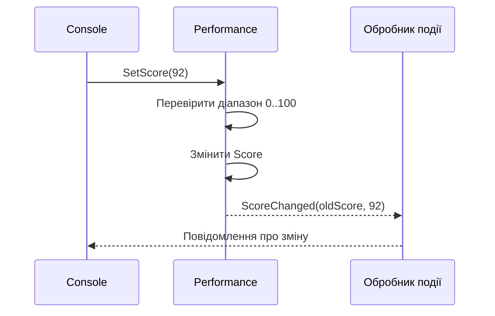

### 3.5. Generic CRUD

**CRUD** = `Create` (створити), `Read` (прочитати), `Update` (оновити), `Delete` (видалити). У [`CrudService<T>`](MusicContest.Common/Services/CrudService.cs) один код обслуговує будь-який тип, який реалізує `IEntity` і має `Guid Id`.

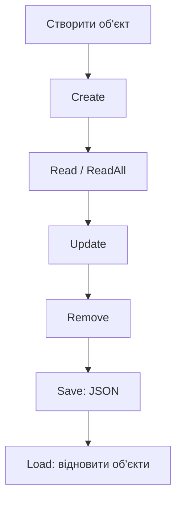

**Чому generic (`<T>`)?** Не потрібно створювати окремий `SingerCrudService`, `SongCrudService` і `PerformanceCrudService` з однаковими операціями.

**JSON** (`JavaScript Object Notation`): текстовий формат обміну даними. У ЛР1 `Save` записує серіалізовані об'єкти, а `Load` відновлює їх зі збереженого файлу. На відміну від SQLite (ЛР3), JSON-файл не має таблиць, зовнішніх ключів і SQL-запитів.

**Де код:** [`Program.cs`](MusicContest.Console/Program.cs), [`CrudService.cs`](MusicContest.Common/Services/CrudService.cs), [`Performance.cs`](MusicContest.Common/Models/Performance.cs), [`ContestParticipantExtensions.cs`](MusicContest.Common/Extensions/ContestParticipantExtensions.cs).

---

## 4. Лабораторна №2. Багатопотоковість, асинхронність, IEnumerable та LINQ

### 4.1. Мета

Опанувати `Task`, `async/await`, паралельні обчислення, примітиви синхронізації, безпечні колекції, перебір `IEnumerable<T>` і LINQ-запити.

### 4.2. Асинхронність ≠ паралельність

| Поняття | Коротко | Наш приклад |
|---|---|---|
| **`Task<T>`** | Об'єкт, що представляє результат асинхронної операції | `Task<bool> CreateAsync(...)` |
| **`async/await`** | Дозволяє очікувати операцію, не блокуючи потік на весь час очікування | `await service.SaveAsync()` |
| **Паралельність** | Виконання кількох частин роботи одночасно | `Parallel.For` створює 2000 пісень |
| **Конкурентність** | Кілька операцій претендують на спільний ресурс | Одночасне додавання до CRUD |
| **Thread safety** | Узгоджена робота зі спільним станом | `ConcurrentDictionary<Guid,T>` |

Саме слово `async` не означає запуск на іншому потоці. Паралельне виконання обчислень і асинхронне очікування розв'язують різні завдання.

У цій реалізації CRUD-методи працюють зі словником `ConcurrentDictionary` синхронно, а `Task.Yield()` планує асинхронне продовження. Це приклад асинхронного контракту, а не асинхронного доступу до сховища. Метод `SaveAsync()` виконує реальний асинхронний файловий запис через `File.WriteAllTextAsync()`.

### 4.3. Як працює паралельне створення 2000 об'єктів

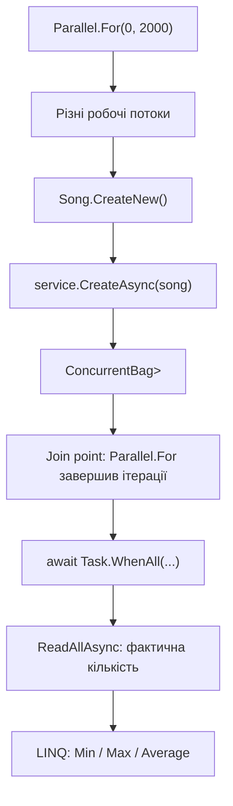

Після завершення `Parallel.For` усі його ітерації вже виконані. Завдання, запущені всередині циклу, можуть ще працювати, тому наступним кроком викликається `Task.WhenAll`. Такий порядок реалізовано в [`Parallell.cs`](MusicContest.Common/Services/Parallell.cs).

### 4.4. Примітиви синхронізації

| Інструмент | Що гарантує | Демонстрація |
|---|---|---|
| `lock` | Лише один потік одночасно в критичній секції | 8 потоків × 10 000 інкрементів |
| `SemaphoreSlim(3)` | Не більше трьох одночасних операцій | 10 worker'ів, обмеження паралелізму |
| `AutoResetEvent` | Сигнал пробуджує одного з потоків-очікувачів | Producer / consumer |
| `Interlocked` | Атомарне збільшення чи інша операція зі змінною | Лічильники |
| `ConcurrentDictionary` | Потокобезпечний словник | CRUD за `Guid Id` |

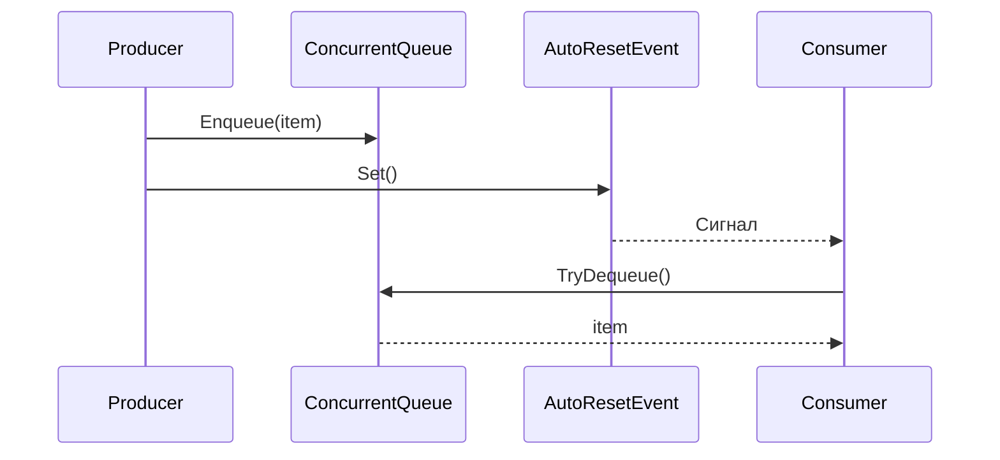

### 4.5. LINQ та колекції

**LINQ** (`Language Integrated Query`): можливість виконувати запити до колекцій без окремої мови запитів.

```csharp
var songs = (await songService.ReadAllAsync()).ToList();

int minimum = songs.Min(song => song.DurationSeconds);
int maximum = songs.Max(song => song.DurationSeconds);
double average = songs.Average(song => song.DurationSeconds);

var page2 = songs
    .OrderBy(song => song.Id)
    .Skip(5)
    .Take(5)
    .ToList();
```

У проєкті також показано `Where` (фільтрація), `Select` (проєкція), `Aggregate` (згортка), `OrderBy` (сортування) та `IEnumerable<T>`/`foreach` (перебір). **Пагінація**: сторінка `page` розміром `amount` починається з індексу `(page - 1) * amount`.

**Snapshot**: окрема копія елементів на момент читання. Її повертає [`CrudServiceAsync<T>`](MusicContest.Common/Services/CrudServiceAsync.cs), щоб зовнішній код не отримував сам внутрішній словник. Це поверхнева копія: для посилальних типів елементи залишаються тими самими об'єктами.

### 4.6. Коли який підхід обирати

- **`Task/await`:** операції вводу-виводу (файл, мережа, база даних).
- **`Parallel.For`:** незалежні CPU-операції, які доцільно розподілити між потоками.
- **`lock`:** дуже короткі синхронні критичні секції.
- **`SemaphoreSlim`:** дозований доступ до ресурсу, особливо за наявності `await`.
- **`ConcurrentDictionary`:** багато одночасних читань/записів у словник.

Повні приклади: [`SynchronizationDemos.cs`](MusicContest.Common/Services/SynchronizationDemos.cs), [`CrudServiceAsync.cs`](MusicContest.Common/Services/CrudServiceAsync.cs), [`Parallell.cs`](MusicContest.Common/Services/Parallell.cs).

---

## 5. Лабораторна №3. Entity Framework Core та бази даних

### 5.1. Базові поняття

Реляційна база даних зберігає інформацію в таблицях, пов'язаних ключами. СУБД керує створенням, читанням, оновленням і захистом даних. Приклади: SQLite, PostgreSQL, SQL Server і MySQL. ORM (Object-Relational Mapping) зіставляє об'єкти C# із таблицями та записами. Entity Framework Core є ORM-платформою для .NET.

### 5.2. Два шари моделей: домен і база даних

| Модель ЛР1 | EF-модель ЛР3 | Відмінність |
|---|---|---|
| `ContestParticipant` | `ContestParticipantModel` | Додано `DatabaseId`, зв'язки з профілем, піснями, виступами |
| `SoloSinger` | `SoloSingerModel` | Окрема таблиця TPT |
| `VocalGroup` | `VocalGroupModel` | Окрема таблиця TPT |
| `Song` | `SongModel` | Зовнішні зв'язки та `DatabaseId` |
| `Performance` | `PerformanceModel` | FK `ParticipantDatabaseId`, `SongDatabaseId` |
| Немає відповідника в ЛР1 | `ParticipantProfileModel` | Окрема таблиця для зв'язку 1:1 |

Доменна модель описує поведінку предметної області, наприклад зміну оцінки виступу. Модель БД визначає спосіб збереження: первинні й зовнішні ключі, а також навігаційні властивості.

### 5.3. Чому є і `DatabaseId`, і `Id`?

| Поле | C# | SQLite | Для чого |
|---|---|---|---|
| `DatabaseId` | `int` | `INTEGER` | **PK**, числовий ключ таблиці; на нього посилаються FK |
| `Id` | `Guid` | `TEXT` | Унікальний публічний ідентифікатор об'єкта для сумісності з CRUD ЛР1–ЛР2 |

GUID є глобально унікальним ідентифікатором, а не звичайним ім'ям. SQLite не має окремого вбудованого типу `UUID`, тому EF Core зберігає `Guid` у стовпці `TEXT`. У цій схемі фізичним первинним ключем залишається `INTEGER DatabaseId`.

### 5.4. TPT: Table-per-Type («таблиця для кожного типу»)

Загальні поля `ContestParticipantModel` зберігаються в `ContestParticipants`. Специфічні властивості похідних типів розміщено в `SoloSingers` або `VocalGroups`. Отже, запис однієї співачки займає два рядки в різних таблицях, але в C# це один об'єкт.

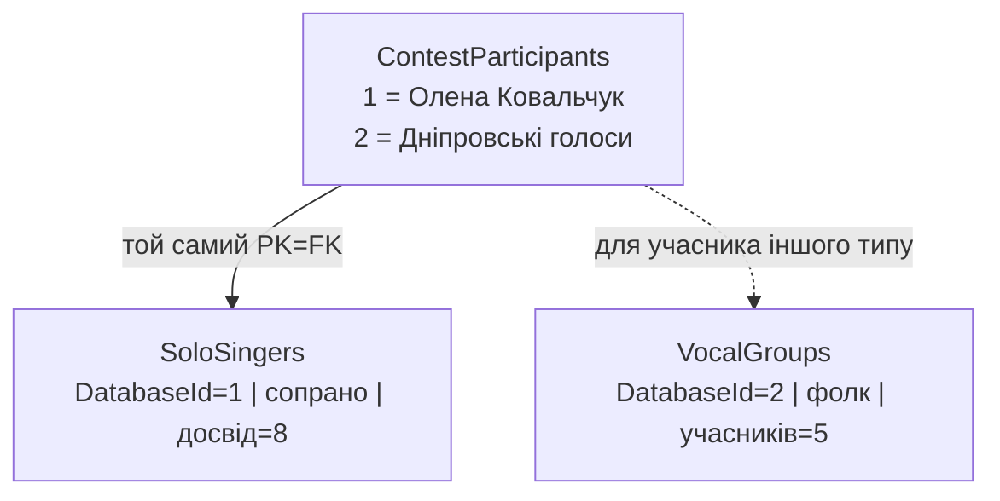

Приклад SQL-запиту, яким можна об'єднати загальні й спеціальні поля:

```sql
SELECT p.DatabaseId, p.StageName, p.Country, s.VoiceType
FROM ContestParticipants AS p
JOIN SoloSingers AS s ON s.DatabaseId = p.DatabaseId;
```

**Навіщо:** не дублювати `StageName`, `Country` та `Age` у кількох таблицях. **Недолік:** читання похідного об'єкта потребує `JOIN`, що може ускладнювати запити. Альтернативи: `TPH` (усі типи в одній таблиці) та `TPC` (окремі повні таблиці для конкретних типів).

У таблицях `SoloSingers` і `VocalGroups` поле `DatabaseId` виконує дві ролі: це і первинний, і зовнішній ключ. Окреме поле `Id` у похідних таблицях не потрібне, оскільки GUID зберігається в базовій таблиці.

### 5.5. DbContext і Fluent API

[`MusicContestContext`](MusicContest.Infrastructure/Data/MusicContestContext.cs) успадковується від `DbContext`. Він описує набори сутностей (`DbSet`), зв'язки між ними та правила створення схеми.

Fluent API задає конфігурацію в методі `OnModelCreating`. Наприклад:

```csharp
modelBuilder.Entity<ParticipantProfileModel>()
    .HasOne(profile => profile.Participant)
    .WithOne(participant => participant.Profile)
    .HasForeignKey<ParticipantProfileModel>(
        profile => profile.ParticipantDatabaseId);
```

Це зв'язок **1:1**: у одного учасника може бути один профіль, а профіль належить одному учаснику. На FK застосовується обмеження унікальності.

Data Annotations задають правила за допомогою атрибутів властивостей, наприклад `[Required]`. Для складних зв'язків і TPT у цьому проєкті використано Fluent API.

### 5.6. Repository Pattern і асинхронний CRUD

Repository («репозиторій») є шаблоном проєктування для відокремлення операцій із даними від конкретного способу їх зберігання. Сервіс звертається до контракту репозиторію, а не виконує SQL-запити й не працює безпосередньо з `DbContext`.

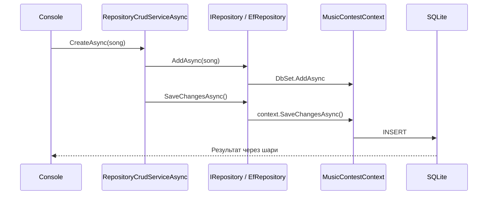

Інтерфейс [`IRepository<T>`](MusicContest.Common/Services/IRepository.cs) описує `GetByIdAsync(int)`, `GetAllAsync()`, `AddAsync`, `Update`, `Delete`; реалізація EF: [`EfRepository.cs`](MusicContest.Infrastructure/Repositories/EfRepository.cs). Наш репозиторій **додатково** містить `SaveChangesAsync`, а [`RepositoryCrudServiceAsync<T>`](MusicContest.Infrastructure/Services/RepositoryCrudServiceAsync.cs) підтримує сумісний із попередньою лабораторною `ReadAsync(Guid)` і пагінацію.

### 5.7. Міграції та версії схеми БД

Міграція описує перехід схеми бази даних від одного стану до іншого. Метод `Up()` створює або змінює таблиці, а `Down()` містить зворотні операції. EF Core записує застосовані міграції до службової таблиці `__EFMigrationsHistory`.

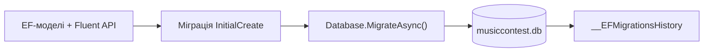

У проєкті є [`20261121130000_InitialCreate.cs`](MusicContest.Infrastructure/Migrations/20261121130000_InitialCreate.cs). Під час запуску консолі викликається `db.Database.MigrateAsync()`. Типові команди для нових міграцій:

```bash
dotnet ef migrations add NextChange --project MusicContest.Infrastructure --startup-project MusicContest.Console
dotnet ef database update --project MusicContest.Infrastructure --startup-project MusicContest.Console
```

Потрібні `dotnet-ef` і відповідні NuGet-пакети EF Core. **Не запускайте `EnsureCreated()` замість `Migrate()`**, якщо хочете підтримувати історію міграцій.

---

## 6. ERD-діаграма та кардинальності

ERD (Entity–Relationship Diagram) показує сутності, їхні атрибути та зв'язки. Кардинальність визначає, скільки записів однієї таблиці може відповідати одному запису іншої.

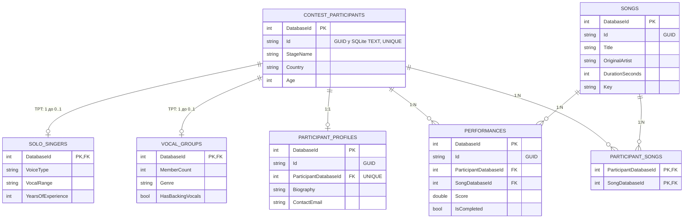

Позначення на ERD: `PK` означає первинний ключ, `FK`: зовнішній. Комбінація `PK,FK` вказує, що одне поле виконує обидві ролі. Символи `||` позначають один запис, `o|`: нуль або один, `o{`: нуль або багато.

### 6.1. Один-до-одного (1:1)

Учасник може мати один профіль. Поле `ParticipantProfiles.ParticipantDatabaseId` є зовнішнім ключем з унікальним індексом. Тому два профілі не можуть належати одному учасникові.

### 6.2. Один-до-багатьох (1:N)

Учасник **може мати багато** виступів; кожний виступ прив'язаний до **одного** учасника через `Performances.ParticipantDatabaseId`. Пісня також може зустрічатися в багатьох виступах через `SongDatabaseId`.

### 6.3. Багато-до-багатьох (M:N)

Один учасник може виконувати кілька пісень. Ту саму пісню можуть обрати різні учасники. Зв'язок зберігає **проміжна таблиця `ParticipantSongs`** із парою ключів:

| ParticipantDatabaseId | SongDatabaseId | Значення |
|---:|---:|---|
| 1 | 1 | Учасник №1 виконує пісню №1 |
| 1 | 2 | Учасник №1 виконує пісню №2 |
| 2 | 1 | Учасник №2 виконує пісню №1 |

Окреме поле `Id` у цій таблиці не потрібне. Пару (`ParticipantDatabaseId`, `SongDatabaseId`) визначено як складений первинний ключ, тому кожен зв'язок має унікальний запис.

**Фактичні зображення:** [ERD](docs/Lab3_ERD.png), [структура БД](docs/Lab3_GUI_DatabaseStructure.png), [таблиця учасників](docs/Lab3_GUI_ContestParticipants.png), [таблиця пісень](docs/Lab3_GUI_Songs.png), [SQLite-файл](docs/musiccontest.db).

---

## 7. MongoDB: додаткове завдання ЛР3

MongoDB є документною NoSQL-базою даних. Вона зберігає документи у форматі BSON, структура якого подібна до JSON.

У [`SongDocument.cs`](MusicContest.Nosql/Models/SongDocument.cs) визначено вкладений об'єкт `Stats` із кількістю голосів і тегами. Ці поля зберігаються **всередині одного документа**.

```json
{
  "DatabaseId": 1,
  "Title": "Червона рута",
  "OriginalArtist": "Володимир Івасюк",
  "Stats": {
    "ListenerVotes": 250,
    "Tags": ["українська музика", "естрада"]
  }
}
```

*Фрагмент ілюструє структуру, а не побайтовий вивід MongoDB; реальний документ також має системний `_id`.*

**Ключова ідея додаткового завдання:** і [`EfRepository.cs`](MusicContest.Infrastructure/Repositories/EfRepository.cs), і [`MongoRepository.cs`](MusicContest.Nosql/Repositories/MongoRepository.cs) реалізують **один контракт `IRepository<T>`**, хоча звертаються до різних сховищ. MongoDB для запуску потрібна окремо; SQLite достатньо для основної частини лабораторної.

---

## 8. Короткий словник термінів

| Термін | Визначення своїми словами |
|---|---|
| **Клас (class)** | Опис типу об'єктів: його властивостей і методів |
| **Об'єкт (object)** | Конкретний екземпляр класу з даними |
| **Властивість (property)** | Дані об'єкта з `get`/`set` |
| **Конструктор** | Метод ініціалізації нового об'єкта |
| **Інтерфейс (interface)** | Контракт: які члени має підтримувати тип |
| **Абстрактний клас** | Спільний тип, який не можна створити безпосередньо |
| **Наслідування** | Похідний клас отримує спільну поведінку базового |
| **Поліморфізм** | Одна операція може мати різну реалізацію в нащадках |
| **Делегат** | Типізоване посилання на метод |
| **Подія (event)** | Механізм повідомлення підписників |
| **Generic (`<T>`)** | Код, який працює з різними типами без дублювання |
| **CRUD** | Create, Read, Update, Delete: операції над записами |
| **JSON** | Текстовий формат структурованих даних |
| **Серіалізація** | Перетворення об'єкта у формат збереження |
| **Task** | Представлення асинхронної операції |
| **async/await** | Зручний синтаксис неблокуючого очікування |
| **Потік (thread)** | Послідовність виконання команд |
| **Гонитва потоків (race condition)** | Результат залежить від непередбачуваного порядку одночасних дій |
| **Критична секція** | Код, доступ до якого потрібно синхронізувати |
| **lock** | Взаємне виключення при доступі до секції |
| **SemaphoreSlim** | Обмежувач кількості одночасних операцій |
| **AutoResetEvent** | Сигнал, який автоматично скидається після пробудження очікувача |
| **Interlocked** | Атомарні операції зі спільними змінними |
| **LINQ** | Запити до колекцій і інших джерел даних засобами C# |
| **IEnumerable** | Контракт послідовного перебору елементів |
| **Snapshot** | Копія стану колекції на момент читання |
| **Пагінація** | Поділ результатів на сторінки |
| **SQL** | Мова запитів до реляційних баз даних |
| **SQLite** | Вбудована реляційна СУБД з файловою базою |
| **СУБД / DBMS** | Програма для керування базами даних |
| **ORM** | Зіставлення об'єктів програми й структур БД |
| **Entity Framework Core** | ORM-платформа Microsoft для .NET |
| **DbContext** | Контекст роботи EF Core з таблицями й змінами |
| **DbSet** | Представлення набору сутностей певного типу в EF Core |
| **Fluent API** | Програмна конфігурація схеми EF Core |
| **PK** | Primary Key: унікальний первинний ключ рядка |
| **FK** | Foreign Key: посилання на ключ іншої таблиці |
| **GUID / UUID** | Глобально унікальний ідентифікатор |
| **1:1** | Одному запису відповідає максимум один запис іншої таблиці |
| **1:N** | Одному запису відповідає багато записів іншої таблиці |
| **M:N** | Багатьом записам можуть відповідати багато інших |
| **Composite Key** | Первинний ключ із кількох стовпців |
| **JOIN** | Об'єднання рядків із кількох таблиць за умовою |
| **ERD** | Схема сутностей, їхніх атрибутів і зв'язків |
| **TPT** | Table-per-Type: окрема таблиця для базового й похідних типів |
| **TPH** | Table-per-Hierarchy: усі типи наслідування в одній таблиці |
| **TPC** | Table-per-Concrete-Type: окрема повна таблиця для кожного конкретного типу |
| **Migration** | Версійна зміна схеми БД |
| **Repository Pattern** | Абстракція для відокремлення доступу до даних |
| **NoSQL** | Нереляційні підходи до моделювання й зберігання даних |
| **MongoDB** | Документна NoSQL СУБД |
| **BSON** | Бінарне подання документів у MongoDB |
| **Git branch** | Незалежна лінія змін коду |
| **Pull Request (PR)** | Запит на перегляд і злиття змін гілки |
| **CI / GitHub Actions** | Автоматизована перевірка збірки, тестів і звітів |

---

## 9. Як запустити й перевірити

### 9.1. Підготовка

Потрібен **.NET SDK 8**. Відкрийте термінал у корені репозиторію. Додатково для перегляду БД використовуйте **DB Browser for SQLite**, а для необов'язкової MongoDB-частини: запущений сервер MongoDB.

```bash
dotnet restore MusicContest.sln
dotnet build MusicContest.sln
dotnet test MusicContest.sln
```

### 9.2. Запуск лабораторних

```bash
# ЛР1 + ЛР2 + ЛР3 в одному запуску:
dotnet run --project MusicContest.Console

# Тільки ЛР1 (після оновлення консолі):
dotnet run --project MusicContest.Console -- --lab1-only

# ЛР1 + ЛР2 без ЛР3 (після оновлення консолі):
dotnet run --project MusicContest.Console -- --lab2-only

# ЛР3 з SQLite:
dotnet run --project MusicContest.Console -- --lab3-only

# Додаткове завдання ЛР3: MongoDB має бути запущено:
dotnet run --project MusicContest.Console -- --lab3-nosql
```

**SQLite:** база `docs/musiccontest.db`. Міграція створює таблиці; демонстрація наповнює їх навчальними українськими записами. Для індивідуальної перевірки відкрийте файл у DB Browser for SQLite → `Browse Data` → оберіть `ContestParticipants`, `Songs`, `Performances` та `ParticipantSongs`. Робота без скріншотів **створеної БД і таблиць** за умовами викладача не зараховується.

### 9.3. Перевірка SQL

```sql
-- Список таблиць:
SELECT name FROM sqlite_master WHERE type='table' ORDER BY name;

-- Учасники з профілями:
SELECT p.DatabaseId, p.StageName, f.Biography
FROM ContestParticipants p
LEFT JOIN ParticipantProfiles f
    ON f.ParticipantDatabaseId = p.DatabaseId;

-- Учасники з піснями (M:N):
SELECT p.StageName, s.Title
FROM ParticipantSongs ps
JOIN ContestParticipants p ON p.DatabaseId = ps.ParticipantDatabaseId
JOIN Songs s ON s.DatabaseId = ps.SongDatabaseId
ORDER BY p.StageName, s.Title;

-- Успішно застосовані міграції:
SELECT * FROM __EFMigrationsHistory;
```

### 9.4. Доказові файли

| Лабораторна | Звіт / дані |
|---|---|
| ЛР1 | [`docs/Lab1_Report.pdf`](docs/Lab1_Report.pdf), код консолі та демонстрація JSON |
| ЛР2 | [`docs/Lab2_Report.pdf`](docs/Lab2_Report.pdf), [`Lab2_output.txt`](docs/Lab2_output.txt), [`Lab2_test.txt`](docs/Lab2_test.txt) |
| ЛР3 | [`docs/Lab3_Report.pdf`](docs/Lab3_Report.pdf), [`musiccontest.db`](docs/musiccontest.db), [`Lab3_ERD.png`](docs/Lab3_ERD.png), [`Lab3_DB_Tables.png`](docs/Lab3_DB_Tables.png) |
| Реальні GUI-скріншоти | [структура](docs/Lab3_GUI_DatabaseStructure.png), [учасники](docs/Lab3_GUI_ContestParticipants.png), [пісні](docs/Lab3_GUI_Songs.png), [виступи](docs/Lab3_GUI_Performances.png) |
| Додаткове завдання | [документи MongoDB](docs/Lab3_MongoDB.png), [MongoDB-консоль](docs/Lab3_mongodb_output.txt) |
| Перевірка CI | [`Lab3_build.txt`](docs/Lab3_build.txt), [`Lab3_test.txt`](docs/Lab3_test.txt), [`GitHub Actions`](.github/workflows/lab3.yml) |

*Правило достовірності:* показуйте лише фактично отримані логи, структуру БД та скріншоти. Статус тестів і числа в документації потрібно звіряти з актуальним запуском, а не переносити зі старого звіту.

---

## 10. Підказки та контрольні запитання

### 10.1. «Одним реченням» для усного захисту

| Запитання викладача | Стисла відповідь |
|---|---|
| Що демонструє ЛР1? | Класи, наслідування, поліморфізм, делегати, події та generic CRUD |
| Що додає ЛР2? | Асинхронний CRUD, потокобезпечність, паралельність і LINQ |
| Що додає ЛР3? | EF Core, реляційну БД, міграції, зв'язки таблиць і Repository |
| Навіщо абстрактний `ContestParticipant`? | Щоб спільні поля не дублювалися у `SoloSinger` і `VocalGroup` |
| Чим `async` відрізняється від `Parallel`? | `async` дає неблокуюче очікування, а `Parallel` розподіляє незалежну роботу між потоками |
| Чому потрібен `ConcurrentDictionary`? | Щоб знизити ризик гонитви потоків при конкурентному доступі |
| Що таке TPT? | Спільні поля: в базовій таблиці, специфічні: в окремих таблицях похідних типів |
| Чому `Guid`: `TEXT` у SQLite? | SQLite не має окремого стандартного типу UUID, GUID серіалізується в текст |
| Чому у `SoloSingers` немає окремого `Id`? | `DatabaseId` одночасно PK і FK до базової таблиці TPT |
| Чому у `ParticipantSongs` немає окремого `Id`? | Два FK разом утворюють складений первинний ключ |
| Навіщо `DbContext`? | Для запитів, конфігурації моделей, відстеження змін і збереження до БД |
| Навіщо Repository? | Щоб CRUD не залежав від конкретної СУБД або способу збереження |
| Що таке міграція? | Опис зміни схеми БД, яку EF Core застосовує до сховища |

### 10.2. Найчастіші помилки

1. **Плутати `Guid Id` і `int DatabaseId`.** Перший: ідентифікатор об'єкта, другий: PK таблиці SQLite.
2. **Вважати, що `SoloSingers`: незалежна повна таблиця.** У TPT вона доповнює `ContestParticipants`.
3. **Називати M:N прямим FK між двома таблицями.** У нашій схемі M:N реалізовано через `ParticipantSongs`.
4. **Застосовувати `async` як синонім багатопотоковості.** Очікування I/O: не те саме, що паралельні обчислення.
5. **Вважати `SaveAsync` ЛР2 і `SaveAsync` ЛР3 однаковими за реалізацією.** У ЛР2 це JSON, у ЛР3: `SaveChangesAsync` через репозиторій.
6. **Плутати доменну й EF-модель.** Домени описують поведінку; EF-моделі: збереження, FK і навігацію.
7. **Додавати до звіту вигадані скріншоти.** Вимога: знімки фактично створеної БД.

### 10.3. Де читати розгорнуті відповіді

- [Контрольні запитання ЛР1](CONTROL_QUESTIONS.md).
- [Контрольні запитання ЛР2](LAB2_CONTROL_QUESTIONS.md).
- [13 контрольних запитань ЛР3](LAB3_CONTROL_QUESTIONS.md).

### 10.4. Перевірка засвоєння матеріалу

Спробуйте **без підказки** пояснити, що відбудеться, якщо: (а) створити дві пісні з одним `Guid Id`; (б) двічі додати ту саму пару учасник–пісня; (в) викликати `ReadAllAsync(0, 10)`; (г) видалити учасника, який має профіль і виступи; (ґ) змінити схему EF-моделі без міграції.

**Орієнтир для відповіді:** у CRUD є перевірка повторного GUID; в `ParticipantSongs` діє складений PK; нульова сторінка недопустима; поведінка видалення визначається `DeleteBehavior` у Fluent API; зміни моделі потрібно узгоджувати з реальною схемою БД через міграції.

---

## 11. Офіційні джерела та додаткова література

Наведені джерела рекомендуються для поглибленого вивчення й перевірки визначень. **Файли проєкту та фактичні SQL-таблиці** є джерелом прикладів, а **документація розробників**: джерелом теоретичних пояснень.

1. Microsoft Learn. [Inheritance: EF Core](https://learn.microsoft.com/en-us/ef/core/modeling/inheritance). Стратегії відображення наслідування TPH, TPT та TPC.
2. Microsoft Learn. [Migrations Overview: EF Core](https://learn.microsoft.com/en-us/ef/core/managing-schemas/migrations/). Принципи версіонування схеми БД.
3. Microsoft Learn. [Asynchronous programming with async and await](https://learn.microsoft.com/en-us/dotnet/csharp/asynchronous-programming/). Модель асинхронного виконання в C#.
4. MongoDB Documentation. [.NET/C# Driver](https://www.mongodb.com/docs/drivers/csharp/current/). Доступ до документів MongoDB, CRUD та способи взаємодії.
5. MongoDB Documentation. [Driver Quick Reference](https://www.mongodb.com/docs/drivers/csharp/current/reference/quick-reference/). Конкретні приклади асинхронних запитів і модифікації документів.

**Принцип наукової доброчесності:** приклади імен учасників та конкурсних колективів є вигаданими; відомі назви українських пісень наведено як навчальний репертуар. Значення оцінок, голосів, тривалості та тональності використовуються для моделювання, а не як перевірені історичні факти про виконавців.

---

**Підсумок:** у ЛР1 створено об'єктну модель і CRUD-сервіс. У ЛР2 додано асинхронну роботу, синхронізацію та LINQ. У ЛР3 реалізовано збереження даних у SQLite й MongoDB. Усі три роботи побудовано на спільній предметній області MusicContest і демонстраційних даних українського вокального конкурсу.
