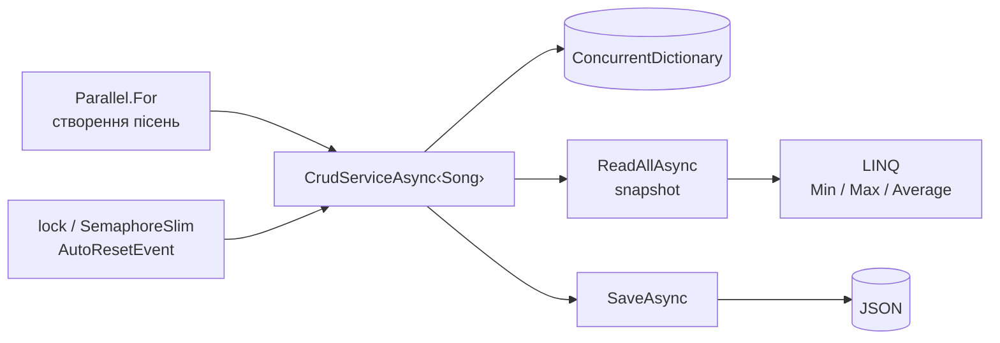

# Лабораторна робота №2. MusicContest

**Тема:** багатопотоковість, асинхронність, IEnumerable та LINQ.  
**Предметна область:** український вокальний конкурс.

[Повний PDF-звіт](Lab2_Report.pdf) · [Прев’ю першої сторінки](Lab2_Report_preview.png) · [Результат запуску](Lab2_output.txt) · [Контрольні запитання](../LAB2_CONTROL_QUESTIONS.md) · [Тести](Lab2_test.txt)

## Результат

Розширено модель першої лабораторної. Реалізовано `CrudServiceAsync<T>` із `ConcurrentDictionary<Guid,T>`, підтримкою `IEnumerable<T>`, пагінацією та асинхронним JSON-збереженням. Програма демонструє конкурентний доступ, синхронізацію потоків і запити LINQ.

## Схема виконання

## Перевірені результати

| Операція | Результат |
|:--|:--|
| Збірка .NET | Успішна |
| xUnit | **22 з 22 тестів** |
| Паралельне створення | 2000 об'єктів |
| Збереження JSON | 2000 записів |
| `lock` | Лічильник 80 000 |
| `SemaphoreSlim` | Щонайбільше 3 одночасні операції |
| `AutoResetEvent` | 500 створених та оброблених елементів |

Показники наведено за [журналом запуску](Lab2_output.txt), [журналом тестів](Lab2_test.txt) і [PDF-звітом](Lab2_Report.pdf). Окремо збережено [журнал збірки](Lab2_build.txt).

Асинхронний метод не обов'язково виконується в окремому потоці. У CRUD-методах операції зі словником синхронні, а `Task.Yield()` забезпечує асинхронне продовження. Файловий запис у `SaveAsync()` використовує `File.WriteAllTextAsync()`.

**Перевірка:** `dotnet test MusicContest.Common.Tests/MusicContest.Common.Tests.csproj`.
