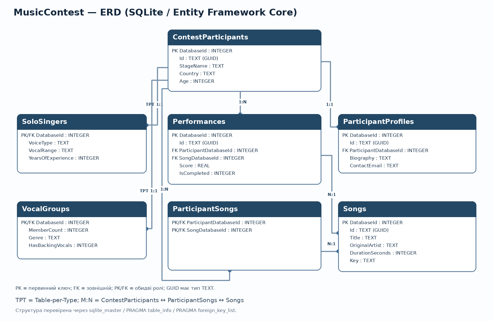

# MusicContest
### Лабораторна робота №3 — Entity Framework Core та бази даних

**Технології:** C# · .NET 8 · Entity Framework Core · SQLite · MongoDB  
**Предметна область:** український вокальний конкурс

| Підсумок перевірки | Значення |
|:--|--:|
| Збірка .NET | Успішна, 0 помилок |
| Автоматизовані тести | **27 / 27** |
| Учасники конкурсу | 6 |
| Пісні українського репертуару | 8 |
| Виступи | 12 |
| Зв'язки учасників із піснями | 12 |

**Основні результати:** [PDF-звіт](https://github.com/ZvezniyLord/NUPP_NET_2026_-404TH-_TK_-Galenko-_Lab/blob/lab3/docs/Lab3_Report.pdf) · [ERD-діаграма](https://github.com/ZvezniyLord/NUPP_NET_2026_-404TH-_TK_-Galenko-_Lab/blob/lab3/docs/Lab3_ERD.png) · [SQLite-база](https://github.com/ZvezniyLord/NUPP_NET_2026_-404TH-_TK_-Galenko-_Lab/blob/lab3/docs/musiccontest.db) · [Скріншоти таблиць](https://github.com/ZvezniyLord/NUPP_NET_2026_-404TH-_TK_-Galenko-_Lab/blob/lab3/docs/Lab3_GUI_ContestParticipants.png) · [Навчальний довідник](https://github.com/ZvezniyLord/NUPP_NET_2026_-404TH-_TK_-Galenko-_Lab/blob/lab3/README.md)

---

## Архітектура рішення

\`\`\`mermaid
flowchart LR
    A["Консольний застосунок MusicContest.Console"] --> B["Асинхронний CRUD RepositoryCrudServiceAsync"]
    B --> C["IRepository‹T›"]
    C --> D["EfRepository‹T›"]
    D --> E["EF Core MusicContestContext"]
    E --> F[("SQLite")]
    C --> G["Додаткове завдання MongoRepository‹T›"]
    G --> H[("MongoDB")]
\`\`\`

## Реалізовано

| Складова | Виконання |
|:--|:--|
| **Моделі та наслідування** | Окремий \`MusicContest.Infrastructure\`, стратегія **Table-per-Type (TPT)** |
| **Реляційні зв'язки** | **1:1** — учасник/профіль; **1:N** — учасник/виступи; **M:N** — учасники/пісні |
| **Entity Framework Core** | \`MusicContestContext\`, конфігурація через Fluent API, міграція \`InitialCreate\` |
| **Repository Pattern** | Універсальний \`IRepository<T>\`, \`EfRepository<T>\`, асинхронні операції CRUD |
| **Демонстрація** | Консольний застосунок, запис/читання з SQLite, пагінація, тестування |
| **Додаткове завдання** | \`MusicContest.Nosql\`, репозиторій MongoDB, вкладені документи |

## ERD — відносини між таблицями

**Позначення:** PK — первинний ключ; FK — зовнішній ключ; PK/FK — спільний ключ для наслідування TPT; GUID зберігається у SQLite як TEXT.

## Матеріали до перевірки

| Матеріал | Посилання |
|:--|:--|
| **Повний PDF-звіт ЛР3** | [Відкрити звіт](https://github.com/ZvezniyLord/NUPP_NET_2026_-404TH-_TK_-Galenko-_Lab/blob/lab3/docs/Lab3_Report.pdf) |
| Файл реляційної бази даних | [musiccontest.db](https://github.com/ZvezniyLord/NUPP_NET_2026_-404TH-_TK_-Galenko-_Lab/blob/lab3/docs/musiccontest.db) |
| Структура таблиць у DB Browser | [Скріншот структури](https://github.com/ZvezniyLord/NUPP_NET_2026_-404TH-_TK_-Galenko-_Lab/blob/lab3/docs/Lab3_GUI_DatabaseStructure.png) |
| Записи таблиці учасників | [Скріншот учасників](https://github.com/ZvezniyLord/NUPP_NET_2026_-404TH-_TK_-Galenko-_Lab/blob/lab3/docs/Lab3_GUI_ContestParticipants.png) |
| Записи таблиці пісень | [Скріншот пісень](https://github.com/ZvezniyLord/NUPP_NET_2026_-404TH-_TK_-Galenko-_Lab/blob/lab3/docs/Lab3_GUI_Songs.png) |
| MongoDB: додаткове завдання | [Документи MongoDB](https://github.com/ZvezniyLord/NUPP_NET_2026_-404TH-_TK_-Galenko-_Lab/blob/lab3/docs/Lab3_MongoDB.png) |
| Результати компіляції та тестів | [Build](https://github.com/ZvezniyLord/NUPP_NET_2026_-404TH-_TK_-Galenko-_Lab/blob/lab3/docs/Lab3_build.txt) · [Tests](https://github.com/ZvezniyLord/NUPP_NET_2026_-404TH-_TK_-Galenko-_Lab/blob/lab3/docs/Lab3_test.txt) |
| Результати роботи консолі | [SQLite CRUD](https://github.com/ZvezniyLord/NUPP_NET_2026_-404TH-_TK_-Galenko-_Lab/blob/lab3/docs/Lab3_output.txt) · [MongoDB CRUD](https://github.com/ZvezniyLord/NUPP_NET_2026_-404TH-_TK_-Galenko-_Lab/blob/lab3/docs/Lab3_mongodb_output.txt) |
| Відповіді на 13 контрольних запитань | [Контрольні запитання](https://github.com/ZvezniyLord/NUPP_NET_2026_-404TH-_TK_-Galenko-_Lab/blob/lab3/LAB3_CONTROL_QUESTIONS.md) |
| **Лабораторні №1–2** | [PDF ЛР1](https://github.com/ZvezniyLord/NUPP_NET_2026_-404TH-_TK_-Galenko-_Lab/blob/lab3/docs/Lab1_Report.pdf) · [PDF ЛР2](https://github.com/ZvezniyLord/NUPP_NET_2026_-404TH-_TK_-Galenko-_Lab/blob/lab3/docs/Lab2_Report.pdf) |

### Запуск для перевірки

\`\`\`bash
dotnet restore MusicContest.sln
dotnet build MusicContest.sln
dotnet test MusicContest.sln
dotnet run --project MusicContest.Console -- --lab3-only
\`\`\`

Додаткова MongoDB-демонстрація: \`dotnet run --project MusicContest.Console -- --lab3-nosql\` (потрібна запущена MongoDB).

Докладний опис класів, термінів, зв'язків, TPT і механізмів ЛР1–ЛР3: **[навчально-науковий довідник README.md](https://github.com/ZvezniyLord/NUPP_NET_2026_-404TH-_TK_-Galenko-_Lab/blob/lab3/README.md)**.

*Усі демонстраційні учасники мають українські імена або назви колективів; їхні особи та заявки є навчальними прикладами. Пісні представляють український репертуар.*
