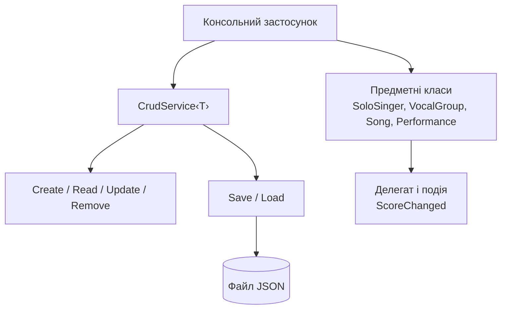

# Лабораторна робота №1. MusicContest

**Тема:** основи C#, об'єктноорієнтоване програмування та узагальнений CRUD.  
**Предметна область:** український вокальний конкурс.

[Повний PDF-звіт](Lab1_Report.pdf) · [Результат роботи програми](Lab1_output.txt) · [Контрольні запитання](../CONTROL_QUESTIONS.md) · [Вихідний код](../MusicContest.Common/)

## Результат

Створено предметну модель учасників музичного конкурсу. Клас `ContestParticipant` містить спільні властивості, від нього успадковуються `SoloSinger` і `VocalGroup`. Окремо описано пісні та виступи. CRUD-сервіс керує записами за ідентифікатором `Guid`, а збереження та завантаження здійснюються через JSON.

## Схема роботи

## Що продемонстровано

| Частина роботи | Зміст |
|:--|:--|
| Об'єктна модель | Абстрактний клас, конструктори, наслідування та перевизначення методів |
| Узагальнений CRUD | Операції над колекцією `List<T>` |
| Делегати й події | Реакція на зміну оцінки виступу |
| Серіалізація | Збереження і відновлення JSON |
| Перевірка | Збірка .NET та запуск консольної демонстрації |

## Матеріали для подання

[PDF-звіт](Lab1_Report.pdf) містить фактичні результати збірки й роботи консольної програми. [Журнал збірки](Lab1_build.txt) та [журнал запуску](Lab1_output.txt) збережені окремо.

Короткий технічний опис: [README.md](../README.md). Правила оформлення: [мовна політика](../EDITORIAL_LANGUAGE_POLICY.md) та [редакційний стандарт](../EDITORIAL_WRITING_STANDARD.md).

**Запуск:** `dotnet run --project MusicContest.Console`.
